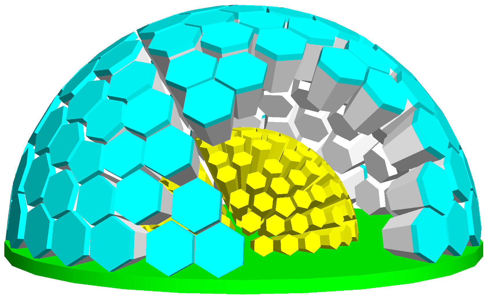

# From gamma-ray burst to sky direction

::::{container} ce-hero

:::{container} ce-hero-copy

**Crystal Eye · ACME Hands-on**

Can you spot a gamma-ray burst in a fluctuating background? Use simulated detector data to find the burst and estimate where it came from.

[Run Python in the notebook](notebook/Crystal-Eye-ACME-Python.ipynb)

[Open in JupyterLab on Binder](https://mybinder.org/v2/gh/francesco-basciani/crystal-eye-acme-tutorial/03dc63ffdc902c6d959490553bf7f2cc8e98819a?urlpath=lab/tree/book/notebook/Crystal-Eye-ACME-Python.ipynb)

[Try the alternate Binder server](https://2i2c.mybinder.org/v2/gh/francesco-basciani/crystal-eye-acme-tutorial/03dc63ffdc902c6d959490553bf7f2cc8e98819a?urlpath=lab/tree/book/notebook/Crystal-Eye-ACME-Python.ipynb)

[Read the exercise instructions](hands-on.md)

:::

:::{container} ce-hero-visual

:::

::::

## The exercise

::::{container} ce-stages

:::{container} ce-stage
**Generate a burst**

Set the incoming direction and spectrum, then inspect the detector response.
:::

:::{container} ce-stage
**Detect an excess**

Look for the burst in the noisy counts before revealing the injected signal.
:::

:::{container} ce-stage
**Reconstruct the direction**

Compare the pixel pattern with simulated templates and inspect the angular separation.
:::

::::

## Detector and simulation

Start with the [detector geometry](theory/detector.md), then see how the simulations produce the [orbital background](theory/background.md) and [response templates](theory/response.md). The theory pages use the figures from Ritabrata’s tutorial outline.
